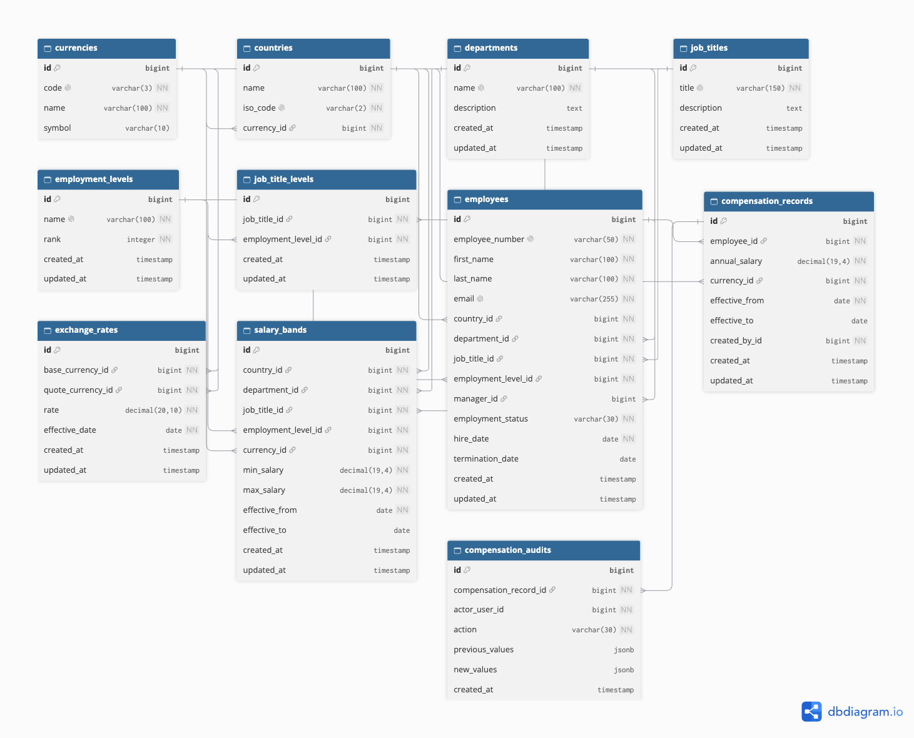

# Salary Manager DB Diagram

Considered whether to keep / remove employment level, when we have job title levels

But decided to keep it, because if we want to compare compensation across employees at equivalent levels, even when their job titles differ, this will be useful. 

